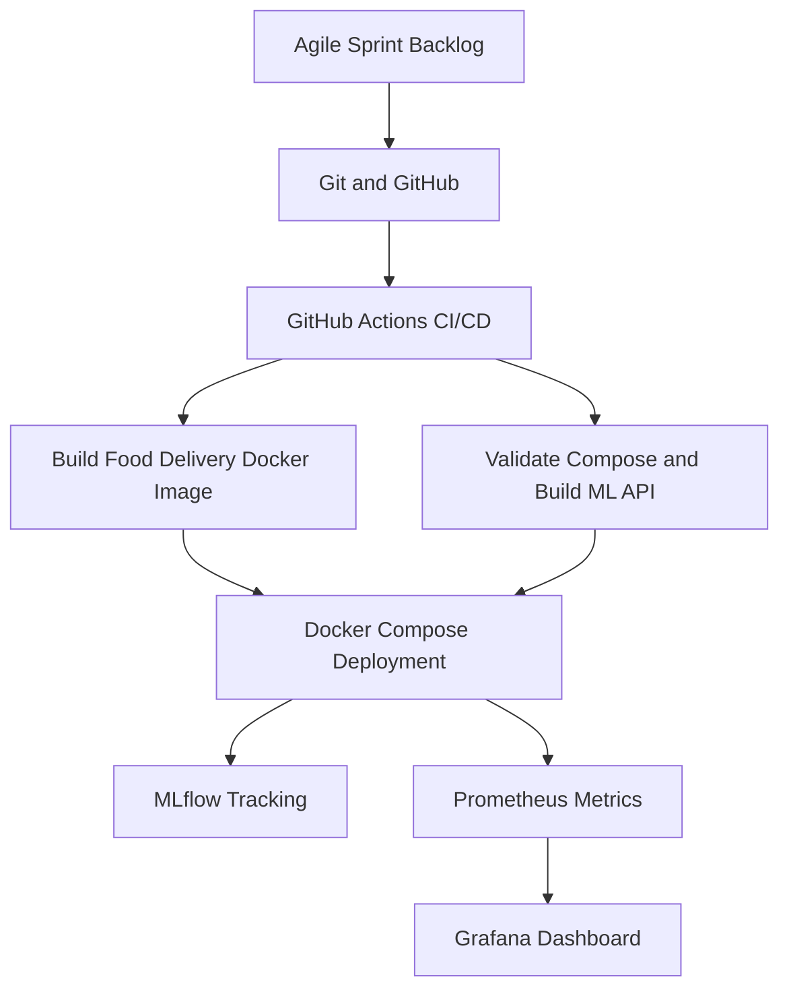

# Q3: End-to-End DevOps Pipeline

## 1. Objective

To integrate Agile planning, Git version control, CI/CD automation,
Docker deployment, and application monitoring into one workflow.

## 2. Agile Sprint Backlog

| Task                                 | Priority | Status |
| ------------------------------------ | -------- | ------ |
| Develop Food Delivery website        | High     | Done   |
| Create Dockerfile and Docker Compose | High     | Done   |
| Configure GitHub Actions CI/CD       | High     | Done   |
| Add MLflow experiment tracking       | High     | Done   |
| Configure Prometheus and Grafana     | High     | Done   |
| Integrate both builds into CI/CD     | High     | Done   |

## 3. Architecture

## 4. Tools Used

- Agile planning: Sprint backlog
- Version control: Git and GitHub
- CI/CD: GitHub Actions
- Containerization: Docker
- Deployment: Docker Compose
- ML lifecycle: MLflow
- Monitoring: Prometheus and Grafana

## 5. Workflow

1. Plan application tasks in the sprint backlog.
2. Store application code in a GitHub repository.
3. Push code changes to the main branch.
4. GitHub Actions checks website files and builds Docker images.
5. Docker Compose runs the application services locally.
6. MLflow tracks model parameters, metrics, and versions.
7. Prometheus collects API metrics, and Grafana displays monitoring data.

## 6. Execution Evidence

- GitHub Actions workflow runs completed successfully.
- Food Delivery website deployed locally using Docker Compose.
- MLflow experiment and registered model version created.
- Prometheus target status verified as UP.
- Grafana dashboard displayed the ML API status.

## 7. Conclusion

The project demonstrates an integrated DevOps workflow combining
Agile planning, version control, automated builds, containerized
deployment, ML lifecycle tracking, and monitoring.
